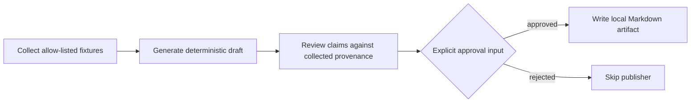
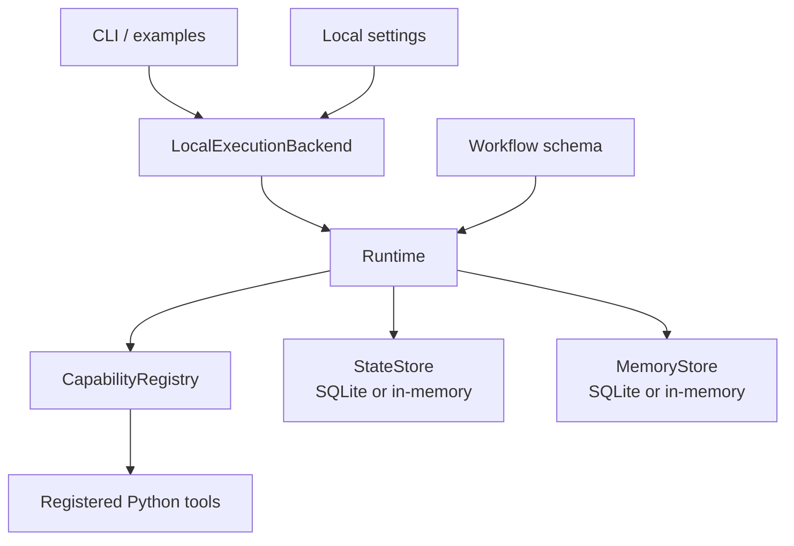

# AGOS

**A local, workflow-first Python framework for capability-scoped autonomous agent workflows.**

AGOS is a small, dependency-free reference implementation—not a hosted platform. It validates serializable workflow graphs, invokes registered tools only through declared agent capabilities, and records local run state and events in SQLite.

> [!IMPORTANT]
> **Status — local vertical slice.** AGOS runs synchronously in one Python process. It has no HTTP API, queue, or worker processes. Fixture sources remain the default; an opt-in HTTPS research connector is available only through a separate capability, pre-registered source IDs, an explicit host allowlist, and a credential-free stdlib transport. Its opt-in GitHub Markdown publisher is an injected-client contract exercised only with deterministic fakes in this repository; it does not discover credentials or publish by itself.

## Who it is for

AGOS is for Python developers who want a compact, inspectable reference for agent-workflow boundaries: validated DAGs, explicit tool capabilities, local durable state, and carefully bounded side effects. It is useful for experiments, prototypes, and understanding the execution contract before building a service around similar ideas.

It is **not** a production deployment, distributed scheduler, multi-tenant platform, or sandbox for arbitrary Python tools.

## Feature matrix

| Area | Implemented now | Planned / not included |
| --- | --- | --- |
| Workflow model | Versioned, JSON-safe DAGs with dependencies, routes, and retries | Workflow migration/version policy |
| Execution | Synchronous, single-process runtime with delegation limits and cooperative cancellation | Queue, workers, leases, distributed cancellation |
| Tool access | Agent manifests and capability checks before registered-tool invocation | Process isolation and sandboxing |
| State and memory | In-memory adapters and local SQLite checkpoints, events, idempotency results, and namespaces | Postgres, object storage, multi-host coordination |
| Research-to-Publish | Fixture/fake sources by default; opt-in capability-scoped HTTPS retrieval with pre-registered IDs, exact host allowlist, public-IP validation, redirect revalidation, TLS-pinned stdlib transport, response/type caps, and digest provenance; deterministic draft, provenance review, explicit approval input, idempotent local Markdown artifact, and capability-scoped injected GitHub Markdown adapter | LLM clients, built-in credential handling, HTTP API, production connector |
| Operations | Local CLI and Docker/Compose tooling for tests | HTTP API, remote telemetry, production topology |

Planned items are not available through configuration flags. See the [roadmap](docs/ROADMAP.md) for scope and priorities.

## 5-minute quickstart

**Requirements:** Python 3.11+ and a checkout of this repository.

```sh
# From the repository root: verify the local implementation
PYTHONPATH=src python3 -m unittest discover -s tests -v

# Run the approved, fixture-only Research-to-Publish demonstration
PYTHONPATH=src python3 -m agos.cli research-to-publish-demo --output-dir /tmp/agos-demo
```

The second command creates `/tmp/agos-demo/local-workflow-demo.md`. It uses caller-provided fixtures and a deterministic provider; it makes no network requests and publishes nowhere external.

Exercise the rejection path instead:

```sh
PYTHONPATH=src python3 -m agos.cli research-to-publish-demo --reject --output-dir /tmp/agos-demo
```

That run skips the publisher and creates no artifact. For installation options, file-backed state, and expected output, read [Getting started](docs/GETTING_STARTED.md).

To exercise the approved route without creating an artifact, use the no-effect
dry-run publisher:

```sh
PYTHONPATH=src python3 -m agos.cli research-to-publish-demo --dry-run --output-dir /tmp/agos-demo
```

The dry-run receipt reports `target: "dry-run"`; it makes no network calls,
does not publish externally, and writes no file.

## Canonical Research-to-Publish flow



The workflow is deliberately narrow:

1. `FixtureSourceAdapter` returns only supplied `SourceFixture` values—there is no scraper or live fetcher.
2. `DeterministicProvider` returns caller-provided responses—it is not an LLM client.
3. Claim review prevents approval if a claim refers to an uncollected source ID.
4. `HumanApprovalGateTool` consumes an explicit `approved` or `rejected` workflow input; there is no interactive approval service.
5. `LocalMarkdownPublisherTool` creates one Markdown file beneath a caller-selected directory and reports `external_publish: false`.
6. `HTTPSResearchConnector` is opt-in: a separate `research.collect.https` capability, pre-registered source IDs, exact HTTPS host allowlist, DNS validation that rejects non-public addresses, redirect revalidation, bounded credential-free TLS-pinned transport, content-type allowlist, and SHA-256 provenance are required. Fixture workflows retain `research.collect.fixture` and never fetch.
7. `GitHubMarkdownPublisher` is opt-in: a separate `publish.github_markdown` capability, approved workflow route, repository allowlist, path validation, injected credential source, and injected GitHub client are all required. AGOS ships no live client and tests use a deterministic fake only.

## Architecture at a glance



The runtime checks an active agent's declared capability before each registered-tool invocation, then records local checkpoints and structured events. These are application-level controls, **not** process isolation, tenant isolation, a transaction protocol, or exactly-once delivery. Read the full [architecture](ARCHITECTURE.md) before extending it.

## Repository map

```text
src/agos/                 Runtime, schema, registry, local persistence, and CLI
src/agos/research_to_publish.py  Fixture-default and opt-in HTTPS Research-to-Publish workflows
src/agos/sources.py              Fixture connectors and secure HTTPS source connector
tests/                    Unit tests for runtime and canonical workflow
examples/                 Small local workflow examples
docs/                     Getting started, roadmap, and architecture decisions
deploy/                   Local CLI/test container and Compose tooling
ARCHITECTURE.md           Execution contracts and implementation boundaries
DEPLOYMENT.md             Current deployment limits and prerequisites
```

## Development and testing

```sh
# Run the unit suite from the source checkout
PYTHONPATH=src python3 -m unittest discover -s tests -v

# Run the canonical demo from source
PYTHONPATH=src python3 -m agos.cli research-to-publish-demo --output-dir /tmp/agos-demo

# Exercise the approved route without creating a file or external effect
PYTHONPATH=src python3 -m agos.cli research-to-publish-demo --dry-run --output-dir /tmp/agos-demo

# Optional: run the local test container (Docker required)
docker compose -f deploy/compose.yaml run --rm agos-tests
```

When using a file-backed `SQLiteStateStore`, inspect a run's durable events with:

```sh
PYTHONPATH=src python3 -m agos.cli events ./data/agos-state.db RUN_ID
```

## Documentation

- [Getting started](docs/GETTING_STARTED.md) — setup, demo, local state, and expected outcomes.
- [Architecture](ARCHITECTURE.md) — modules, execution semantics, persistence, and security limits.
- [Roadmap](docs/ROADMAP.md) — current surface versus planned work.
- [Deployment boundaries](DEPLOYMENT.md) — local tooling and production prerequisites.
- [Testing and evaluation](docs/TESTING.md) — reproducible local checks and their limits.
- [Original MVP release checklist](docs/RELEASE_CHECKLIST.md) — release evidence versus production requirements.
- [ADR 0001](docs/adr/0001-local-first-deployment-boundaries.md) — why unsupported backends are rejected.
- [Contributing](CONTRIBUTING.md) · [Security](SECURITY.md) · [Code of Conduct](CODE_OF_CONDUCT.md)

## Roadmap

The HTTPS connector is intentionally narrow: exact host allowlists (no wildcards), port 443 only, GET only, UTF-8 `text/plain`, `text/html`, or `application/json`, 5-second default timeout, 1 MiB cap, and up to three redirects. It sends no credentials, cookies, or caller headers. Service APIs, workers, remote telemetry, and production external publishing clients remain planned only; the GitHub adapter here is a fake-tested, dependency-injected contract rather than a live client. See the detailed [roadmap](docs/ROADMAP.md).

## Security

Do not report suspected vulnerabilities in public issues. Use GitHub private vulnerability reporting when enabled, or a private maintainer contact channel otherwise. AGOS is an in-process local runtime; registered Python tools are not sandboxed, and local state/artifacts may contain sensitive data. Read [SECURITY.md](SECURITY.md) before using it with real inputs.

## License

No `LICENSE` file is included in this revision. Do not assume a license grant; consult the repository maintainer before reuse.
